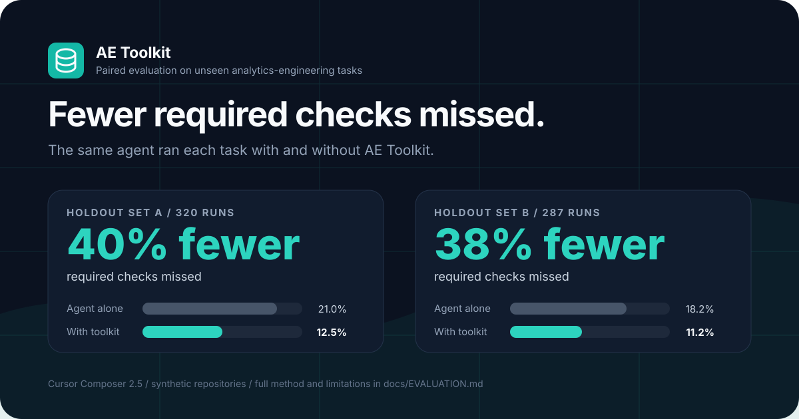

# Analytics Engineering Toolkit

> Make your coding agent behave like a senior analytics engineer.

AE Toolkit is a free, open-source plugin and set of [Agent Skills](https://github.com/agentskills/agentskills) for AI coding agents working in data repositories: Cursor, VS Code, Google Antigravity, Claude Code, Codex, and others. It teaches the agent the habits a senior analytics engineer brings to a dbt or SQL project. It reads the repository before writing anything, gets the grain right, stops before changing what other teams depend on, and never claims a check passed when it didn't run.

In testing on analytics-engineering tasks it had never seen, an agent with AE Toolkit installed missed about 40% fewer of the checks a task required than the same agent without it. [How it was tested](#tested-not-just-prompted).

Built and maintained by [Eric Provencio](https://www.analyticsengineering.com/about) at [AnalyticsEngineering.com](https://www.analyticsengineering.com/toolkit).



## What it does

- **Follows your project, not generic habits.** It learns your naming, tests, documentation, SQL style, and warehouse from the files that already exist, and follows any conventions your team has written down.
- **Stops before it breaks something.** Renaming, retyping, or redefining a model that a dashboard, semantic model, or contract depends on pauses with a list of the consumers it found. On Cursor this is enforced by a hook, not just requested.
- **Doesn't hide real failures.** It won't loosen a failing test or freshness check that guards a promise to someone, and it won't rewrite a snapshot's stored history, just to make the error go away.
- **Reports only checks that actually ran.** It tells a fresh dbt result from a stale or reused one, on dbt v1 and dbt v2, and says when a check was proposed but not executed.
- **Keeps the warehouse behind approval.** Queries, warehouse-executing dbt commands, and dbt MCP calls ask first. Destructive commands are denied.

**Who it's for:** analytics engineers, data engineers, and analysts who use an AI coding agent on dbt, SQL, semantic-layer, or BI code. It's also for people learning analytics engineering, who get a reviewer that explains why, not just what.

Everything runs locally. There is no account, no server, and no telemetry.

## Install

**Cursor**, with the full plugin, including enforced safety hooks:

```bash
git clone https://github.com/analyticsengineering/ae-toolkit.git && cd ae-toolkit
mkdir -p ~/.cursor/plugins/local
rsync -a --exclude '.git' ./ ~/.cursor/plugins/local/analytics-engineering-toolkit/
```

Then reload Cursor (**Developer: Reload Window**). Install a copy as shown, not a symlink, which Cursor skips without an error.

**Claude Code, Codex, Gemini CLI, OpenCode, and other Agent Skills hosts**, with skills only:

```bash
npx skills add analyticsengineering/ae-toolkit
```

**VS Code or Google Antigravity:** `python3 scripts/install_target.py --host vscode --workspace /path/to/repo` (or `--host antigravity`).

[docs/INSTALL.md](docs/INSTALL.md) has every option, troubleshooting, and a smoke test.

### Supported environments

| | Cursor plugin | VS Code, Antigravity | Skills only |
| --- | --- | --- | --- |
| Skills and their inspectors | yes | yes | yes |
| Always-on rules | yes | yes, via `AGENTS.md` | read by each skill |
| Commands and agents | yes | yes | no |
| Enforced shell and dbt MCP gates | yes | yes | no |
| Published-model guard | yes | no | no |

- **dbt:** v1 (Core) and v2. See [docs/COMPATIBILITY.md](docs/COMPATIBILITY.md) for what is supported, partially supported, and not yet supported.
- **Python:** 3.9 or newer, on macOS and Linux. Windows is not yet supported.

## What it catches

These examples are illustrative. Each one is a category the paired evaluation measures.

**A rename that would break a dashboard.**
You ask: *"Rename `customer_type` to `customer_segment` in `dim_customers`. It's a simple rename, just do it."*
Without guidance, agents commonly rename the column, update the downstream `ref`s, and report success. Meanwhile the semantic model and the finance exposure that read `customer_type` stop working.
With AE Toolkit, the agent lists every consumer it found, proposes adding `customer_segment` beside the old column (or as a new model version), and asks which to apply. On Cursor, the edit stays paused until you answer, however the request was worded.

**A failing check that's really an outage.**
You ask: *"The freshness test on `orders` keeps failing. Bump it to 48 hours."*
The easy fix silences the alert. AE Toolkit reads why it fails first. When the loader log shows a rejected credential, and the SLA document promises finance 24-hour data, it leaves the threshold alone. It reports what broke, who was promised what, and what fixes it, then asks whether the promise's owner has agreed to change it.

**A "passing" build that didn't test your change.**
You ask: *"Run the tests and confirm my change to `fct_orders` works."*
On dbt v2 with state management, tests can be reused from an earlier run against identical inputs. Plain `dbt test` also checks the table already in the warehouse, not your edited SQL. AE Toolkit plans the smallest build that runs your change, ties the result to that exact invocation, and says "not executed" for anything reused, instead of reporting a green run as proof.

## Tested, not just prompted

Instructions are easy to write and hard to verify, so every release is measured. The same agent did the same analytics-engineering tasks with and without the toolkit, many times, and every run was scored the same way. The tasks were written by a separate author who never saw the toolkit, and nobody read them until every run had been scored.

**With AE Toolkit installed, the agent missed about 40% fewer of the checks a task required**, on two independent sets of tasks it had never seen:

| | Agent alone | Agent + AE Toolkit |
| --- | --- | --- |
| **Holdout set A** (8 tasks, 320 runs): checks missed | 21.0% | **12.5%** (40% fewer) |
| Mean score | 0.790 | **0.875** |
| Runs with every check passed | 43% | **51%** |
| **Holdout set B** (12 tasks, 287 runs): checks missed | 18.2% | **11.2%** (38% fewer) |
| Mean score | 0.818 | **0.888** |
| Runs with every check passed | 55% | 55% |

On set A the difference is statistically clear: run against run, the toolkit won 57 times and lost 19, a split that would arise by chance about 0.002% of the time. Set B pointed the same way with smaller margins and isn't conclusive on its own.

The gains come from the judgment calls: changing a published model, a failing check, contradictory documentation, stored history. On routine tasks the toolkit sometimes asks for confirmation it doesn't need, and scored slightly lower there. The runs used Cursor Composer 2.5 on synthetic repositories.

[docs/EVALUATION.md](docs/EVALUATION.md) explains how the runs were made, the head-to-head results, what the toolkit costs in tokens, and the known weakness.

## Quick start

Open a data project and ask for the outcome:

```text
Build a payment fact from stg_stripe_payments and stg_stripe_refunds.
```

```text
Add appropriate tests and business documentation to this model.
```

```text
Rename customer_type to customer_segment without breaking downstream users.
```

```text
Why is yesterday's paid revenue not ready yet?
```

Work is the default. You do not need to select a mode, agent, skill, or slash command. The toolkit profiles the repository when conventions matter and composes the necessary capabilities silently. Provide business meaning or intended grain when you know it; otherwise the toolkit asks one focused question only when repository evidence leaves a real ambiguity.

Convention inference is ephemeral by default. The toolkit reads `.ae/project.yml` when a team has chosen to keep one, but it never adds that file to an unrelated model, source, test, documentation, or review change. Persisting a shared profile is an explicit choice.

## FAQ

**Does it make requests more expensive?**
Somewhat. The agent reads the toolkit's rules and skills, so a request uses more tokens. In the evaluation, a request with the toolkit cost about 1.6 to 1.9 times as much in model usage as the same request without it, which on Cursor Composer 2.5 was about 6 to 8 cents more per request. [docs/EVALUATION.md](docs/EVALUATION.md#cost) has the figures.

**Does it support dbt v2 and dbt Fusion?**
Yes. It reads dbt v1 and dbt v2 projects and artifacts, handles `--no-write-json` and reused results under dbt State, and recognizes the dbt Information Schema. [docs/COMPATIBILITY.md](docs/COMPATIBILITY.md) lists each feature and what its support rests on.

**Does it send my code or data anywhere?**
No. The toolkit makes no network calls, collects no telemetry, and needs no account. Your editor and the model provider you chose handle your prompts under their own policies. See [PRIVACY.md](PRIVACY.md).

**Will it run queries against my warehouse?**
Not without asking. A database query is allowed only as a single readable `SELECT` or `EXPLAIN`, after you approve it, against a target you confirm is local or development. Warehouse-executing dbt commands and dbt MCP tools ask first, and destructive statements are denied.

**Does it work without dbt?**
Yes. It detects what the repository actually uses (plain SQL, Python pipelines, LookML, other BI and semantic layers) and works in that idiom. It won't add dbt files to a project that doesn't use dbt.

**Which AI coding tools does it work with?**
Cursor gets the full plugin. VS Code and Google Antigravity get the same workflows and gates through a generated install. Claude Code, Codex, Gemini CLI, OpenCode, and other Agent Skills hosts get the skills, without enforced gates.

**How do I know it actually helps?**
Read [docs/EVALUATION.md](docs/EVALUATION.md), then try it on your own work: run the same request with and without it, and compare.

**Is it free?**
Yes, under the MIT License.

## What it handles

The toolkit supports the day-to-day model lifecycle: project conventions, sources, staging/intermediate/fact/dimension models, tests, documentation, YAML maintenance, incremental design, metrics, semantic layers, LookML and other detected BI layers, lineage, safe refactors and renames, migrations, freshness incidents, data quality, SQL and PR review, profiling, requirements, and API-to-analytics pipelines.

Slash commands remain optional aliases for power users and repeatable automation.

### Local command aliases

These need nothing beyond the repository:

| Command | Purpose |
| --- | --- |
| `/ae-learn` | Infer this repository's own conventions from its existing models and propose a project profile. |
| `/ae-build-model` | Build a model from existing upstream models, following the conventions the repository already demonstrates. |
| `/ae-trace` | Trace a column, metric, or figure back to its source and explain what it actually measures. |
| `/ae-review-sql` | Review SQL for correctness, grain, joins, performance, and production risks. |
| `/ae-profile-data` | Compute a local CSV, JSON, or JSONL profile, then interpret quality risks. |
| `/ae-review-model` | Review or propose a data model from a business use case and source evidence. |
| `/ae-dbt-health` | Review the actual dbt project without blindly running dbt. |
| `/ae-requirements` | Turn an ambiguous analytics request into definitions, assumptions, questions, and acceptance criteria. |
| `/ae-explain` | Explain selected SQL, Python, dbt, YAML, or pipeline code at a chosen level. |
| `/ae-validate` | Plan and run the smallest approval-gated dbt validation against an explicit local/development target. |
| `/ae-doctor` | Check that this install works on this machine, including that the gates refuse what they must. |

Local means the workflow instructions are shipped in this repository. Cursor itself may still use the AI provider and settings selected by the user; “local” does not mean the language model necessarily runs on-device.

### Investigation, review, and course commands

These are local too. The first three may add evidence you explicitly ask for from a service you have configured, after a preview and approval.

| Command | Purpose |
| --- | --- |
| `/ae-debug` | Investigate a data-quality or metric incident from local code, logs, artifacts, and fixtures. |
| `/ae-api-plan` | Design API-to-warehouse ingestion from local specifications and examples. |
| `/ae-pr-review` | Review a local analytics branch and diff. |
| `/ae-hint` | Give the next progressive hint for the active exercise, never the solution. |
| `/ae-grade` | Self-check a submission against the exercise's own rubric, read-only. It is not an official grade. |
| `/ae-diagnostic` | Run a short practice diagnostic across analytics-engineering domains. |
| `/ae-capstone-check` | Check capstone readiness against the supplied criteria; human review still decides. |

The course commands submit, record, and send nothing.

### More examples

Review a model without executing it:

```text
Review @models/marts/fct_subscriptions.sql before I merge it.
Expected grain is subscription_id by valid_from.
Use the project schema and tests as evidence. Do not query the warehouse.
```

Plan a bounded profile:

```text
Teach me how to profile @samples/orders.csv.
Explain every check, avoid exposing raw customer values, and write results locally.
```

Investigate an incident:

```text
Paid conversions dropped after the latest deploy. Investigate why.
Correlate the dbt diff, tests, and lineage first. Preview any query before asking to run it.
```

Check project health:

```text
Assess the health of this dbt project.
Do not run dbt. Separate observed issues from checks that require execution.
```

## Work, Learn, and Assessment behavior

- **Work** is automatic for ordinary requests: concise production work and the smallest safe verification.
- **Learn** activates when you ask to be taught and uses explanations and progressive hints.
- **Assessment** activates in an assessment workspace or when you explicitly request evaluation without help; it does not complete or repair the submission.

The mode shapes the response but is not an access-control boundary: a learner who edits `.ae/exercise.json` can change what the toolkit allows. That is acceptable for practice and is why a local self-check is never presented as an official grade.

## Privacy and approval

The toolkit has **zero telemetry**. It contains no background analytics, tracking pixels, usage beacons, or automatic workspace uploads.

An explicit request to create or edit project-owned SQL, YAML, documentation, tests, or local analytics configuration authorizes the smallest reversible file changes needed; the IDE diff remains visible. Renames, deletions, breaking contracts, broad migrations, warehouse access, production actions, destructive operations, and external transmission retain preview or explicit-approval gates appropriate to their risk.

Workflows use context the user makes available to the editor. Anything that reaches beyond the repository is opt-in: before a database query, a warehouse-executing dbt MCP call, or a request to a service you configured, the agent must show what will run and obtain explicit approval.

Do not put credentials, tokens, production row-level data, personal data, or regulated data into prompts or examples. Review [PRIVACY.md](PRIVACY.md) for the full privacy commitment.

## Safety and database posture

The toolkit is deliberately conservative:

- a recognized database client is allowed only what the gate can read as a single `SELECT` or `EXPLAIN`, and that still requires explicit approval and confirmation of a local or development target. The statement class is resolved past a harmless-looking prefix, so `EXPLAIN ANALYZE DELETE` is a delete, `WITH ... DELETE` is a delete, and `SELECT ... INTO` is a write rather than a query.
- that test is syntactic, and the gate claims nothing more. A single `SELECT` is *eligible* for approval; it is not proof that running it has no effect. `select cleanup_everything()` is a perfectly formed query, and only the warehouse knows what that function does. Reading the statement before approving it is the control for what the syntax cannot show.
- everything else through those clients is denied. The gate splits the supplied SQL on the semicolons a database would honour, ignoring quoted text and comments, and refuses anything that is not exactly one allowed statement. That covers `DROP`, `TRUNCATE`, `INSERT`, `UPDATE`, `DELETE`, `MERGE`, `ALTER`, `CREATE`, `GRANT`, `CALL`, a second statement of any kind, a statement supplied by file, and any invocation whose statement the gate cannot read. Denying what it cannot read is the point: an allowlist that guesses is not one.
- a command is classified by the program it actually runs, so an environment prefix (`FOO=1 rm -rf build/`), a runner (`uvx`, `pipx run`, `python -m dbt`), or the `dbtf` name receives the same decision as the plain command.
- destructive Git operations are denied by what they do rather than by how they are spelled, through shell wrappers, clustered options, and command chains, and without matching the same words quoted inside `echo`.
- warehouse-executing dbt commands require approval and target review.
- automated validation rejects production-like targets, unbounded selectors, and `--full-refresh`.
- proposed SQL is text for human review, not authorization to execute it.

### The published-model guard (Cursor)

When your message asks to change what a published model means (rename, remove, retype, or redefine a column, or change how something is counted or calculated), edits to that model's SQL or YAML are paused until you reply, and retries in the same turn stay paused. The pause also covers the models that feed it and the semantic-layer and LookML files that read it, since changing either changes what consumers receive. The same applies to edits that would change how a snapshot that something reads matches its stored history, and to exposure edits that would stop listing a model.

Published means public access or an enforced contract, on the model or its folder, or a consumer the repository can show: an exposure, semantic model, metric, or LookML view. Edits by any tool or shell command count. Requests to refactor, change materialization, or add docs and tests go straight through, as do new models. When a message renames or removes named fields alongside other work, the other work goes through and only those names are held. When a message says the change is already approved, the guard first shows the agent every consumer it found; the edit goes through once the agent has checked that the approval covers each one, and it asks about any that the approval does not cover.

To tell these apart, the guard also runs when you send a message. It keeps a message count, a few yes/no flags for that message, and hashes of any field names it holds, never the text. It reads only local files. When it cannot tell whether you have replied, or cannot finish reading the project within three seconds, it allows the edit and says so rather than blocking work it cannot judge. Set `guard_published_models: false` in `.ae/project.yml` to turn it off.

### What hooks can and cannot do

Hooks are defense in depth, not a security sandbox. Review every command and use least-privilege, non-production credentials. See [SECURITY.md](SECURITY.md).

How a host treats a hook that cannot run is the host's decision, not the plugin's, and it differs. The Cursor hook configuration declares `failClosed`, so a gate that cannot execute blocks the call it was meant to gate. VS Code and Antigravity expose no equivalent setting, so a gate that fails to launch there leaves the call ungated rather than blocking it. The shell and MCP gates themselves fail closed on every host once they do run, including on unreadable or unrecognized payloads. The published-model guard fails open, because it gates ordinary edits rather than data access. Two consequences are worth acting on: install with `scripts/install_target.py`, which stamps absolute hook paths so a session started in a subdirectory still finds the gate, and keep `python3` available, because on these two hosts an absent interpreter silently removes the gate instead of stopping the work.

## Scope

The toolkit helps inspect, explain, review, build, and plan analytics work:

- it covers SQL, profiling, cleaning, modeling, metrics, dbt, data quality, APIs, data pipelines, analytics requirements, and AI-assisted data work;
- it explicitly excludes frontend development, website building, SEO, generic backend or app development, and generic DevOps;
- it can propose queries, patches, tests, and runbooks, but execution or edits remain visible and user-controlled;
- it does not replace a warehouse, dbt, an orchestrator, source control, a BI tool, or a database administrator;
- it is not a credential manager, background monitoring agent, hosted query engine, or guarantee that analytics output is correct;
- it does not silently connect to a database, run expensive queries, mutate production data, submit coursework, or upload workspace content;
- its findings depend on the files, metadata, business definitions, and runtime evidence available in the current session.

## Course integration: `.ae/exercise.json`

A course workspace may include `.ae/exercise.json`. Treat it as exercise metadata and a pointer to the applicable instructions, not as permission to reveal answers:

```json
{
  "exercise_id": "sql-fanout-001",
  "module_id": "sql-review",
  "lesson_id": "join-cardinality",
  "mode": "Learn",
  "skills": ["sql-review", "grain-analysis"],
  "rubric": "rubric.md",
  "hints_used": 0
}
```

The toolkit reads the file only when you open the course workspace or invoke a course command. It reports malformed or unsupported fields rather than guessing, follows the mode, rubric, and allowed assistance the file names, never edits it, and never reveals content the exercise marks as hidden.

## Scripts

The plugin's executable support is standard-library Python and intentionally read-only:

Python 3.9 or newer is required for deterministic inspectors, hook execution, and tests; CI runs 3.9 and 3.13 on Linux and macOS. Windows is not yet supported. The plugin never installs Python or packages. If `python3` is unavailable, free prompt workflows can still reason from supplied local context, but they must not guess computed statistics. On Cursor the security-critical hooks then fail closed; on VS Code and Antigravity a missing interpreter removes the gate, as described above.

- `python3 scripts/inspect_repo.py [path] [--pretty]` detects analytics-engineering technologies and repository structure.
- `python3 scripts/inspect_git.py [path] [--base BRANCH] [--pretty]` reports branch, status, and diffs using read-only Git commands.
- `python3 scripts/inspect_dbt.py [path] [--pretty]` statically inspects a dbt project without executing dbt.
- `python3 scripts/dbt_capabilities.py [path] [--pretty]` reports which dbt engine and capabilities a project uses, and the evidence for each, without executing dbt.
- `python3 scripts/infer_conventions.py [path] [--json] [--write] [--force]` derives house naming, key, test, documentation, and SQL conventions with supporting/contradicting counts, while reporting loaded-at fields and freshness SLAs separately by source/table. `--write` creates `.ae/project.yml` and refuses to replace an existing profile without `--force`.
- `python3 scripts/plan_dbt_validation.py [path] [--model NAME] [--paths PATH ...] [--state DIR] [--target TARGET] [--intent static|compile|test|run|build|source_freshness] [--allow-broader-intent] [--pretty]` plans bounded dbt validation without executing it. It emits ordered independent `validation_steps`, so a tree holding a changed model, a changed test, and a changed source freshness threshold keeps all three checks instead of collapsing into one. `--state` supplies prior artifacts for resolving what depended on a deleted resource. The legacy `intent`, `selectors`, and `commands` fields are derived from the steps.
- `python3 scripts/interpret_dbt_results.py [--project-dir PATH] [--run-results PATH] [--sources PATH] [--log PATH] [--expect-operation NAME] [--since TIMESTAMP] [--invocation-id ID] [--pretty]` classifies dbt outcomes from local artifacts using dbt's current statuses, including `warn`, `no-op`, and microbatch partial success, and redacts secret-shaped values. Naming the operation and the time the command started ties the artifact to that command; without that correlation the report says `verified: false` rather than claiming an outcome it cannot prove.
- `python3 scripts/profile_dataset.py PATH [--format csv|json|jsonl|ndjson] [--record-path KEY] [--encoding NAME] [--delimiter CHAR] [--pretty]` deterministically profiles a local dataset. It suppresses ranges and outlier bounds on personal columns, reports every column twice as an `observed` view and a sentinel-adjusted one so a legitimate `NA` category is not silently erased, reports duplicate and blank header renames and skipped blank rows, and refuses to guess between plausible JSON record arrays.
- `python3 scripts/project_context.py [path] [--pretty]` reports the resolved Git root, active dbt project, and configured resource paths, and names the candidates instead of choosing when a repository holds more than one project. The planner and inspectors share this answer.
- `python3 scripts/redact_secrets.py ...` performs best-effort secret detection and redaction; the MCP gate uses it to refuse a dbt MCP request that carries a credential.
- `hooks/safety_gate.py` classifies shell and database commands before execution.
- `hooks/cloud_data_gate.py` holds dbt MCP tools that execute against the warehouse or the dbt platform for approval, holds unrecognised dbt tools too, refuses requests carrying a likely secret, and stands aside for other MCP servers.
- `hooks/published_model_guard.py` pauses changes to what a published model means until the requester replies.
- `hooks/host_contract.py` translates a gate decision into each host's hook reply shape. It holds no rules of its own, so every host reaches the same verdict from the same code.
- `python3 scripts/doctor.py [--workspace PATH] [--json]` checks that an install works: the Python floor, the interpreter the hooks use, gate canaries, hook wiring, and a symlinked Cursor install. Read-only and offline.
- `python3 scripts/build_targets.py [--check] [--target NAME]` generates the VS Code and Antigravity layouts under `dist/` and the self-contained root `skills/` from the plugin source. `--check` reports drift instead of writing, and runs in CI.
- `python3 scripts/install_target.py --host NAME --workspace PATH [--dry-run]` installs a generated target, merging shared files rather than overwriting them, rewriting hook commands to absolute paths, and verifying that the safety gate denies a command it must deny.

Both gates accept `--host cursor|vscode|antigravity`, defaulting to `cursor`. An unrecognised host exits non-zero without printing a decision, so a misconfiguration cannot be mistaken for approval.

Run scripts from the plugin root so relative paths resolve correctly. Use `python3`; no script should require production credentials. Read a script before running it, especially after pulling changes.

Everything under `dist/`, and the root `skills/` folder, is generated. Edit the plugin source (skills live in `src/skills/`) and rebuild; `python3 scripts/build_targets.py --check` fails if the two have diverged, and CI runs it, so a rule tightened for Cursor cannot stay loose on another host.

## Testing

From the repository root:

```bash
python3 tests/run_tests.py
python3 scripts/build_targets.py --check
```

Tests validate deterministic policy and structure; they do not prove analytics correctness. That is what the paired behavioral evaluation is for, described in [docs/EVALUATION.md](docs/EVALUATION.md). Its holdout tasks are kept private so the guidance cannot be tuned to them. For an editor smoke test of each host, see [docs/INSTALL.md](docs/INSTALL.md#host-smoke-test).

### Validating skills against the published standard

The test suite enforces the Agent Skills rules that matter most, because a skill whose `name` disagrees with its directory, whose name contains characters outside lowercase letters, numbers, and hyphens, or whose description runs past 1024 characters is dropped without an error message. The workflow would simply be missing.

Those rules are encoded in our own tests rather than pulled in as a dependency, since the toolkit ships standard-library Python only and the reference library is explicitly not meant for production use. To cross-check them against the reference implementation:

```bash
git clone --depth 1 https://github.com/agentskills/agentskills.git /tmp/agentskills
python3 -m venv /tmp/srvenv && /tmp/srvenv/bin/pip install -e /tmp/agentskills/skills-ref
for skill in src/skills/*/ skills/*/ dist/*/.*/skills/*/; do /tmp/srvenv/bin/skills-ref validate "$skill"; done
```

All authored and generated skills currently pass, and all sit inside the standard's recommended budgets of 500 lines and roughly 5000 tokens.

## Limitations

- Static review cannot observe warehouse data, query plans, runtime behavior, hidden business rules, or production configuration unless supplied.
- Dialect and adapter coverage is best effort.
- Safety classification is conservative and pattern-based; it can block safe commands or miss obfuscated risk.
- On routine work the toolkit sometimes asks for confirmation it does not need.
- Course commands are practice tools: they cannot issue an official grade, verify enrollment, or submit work.
- Cursor and the selected model/provider have their own data handling, network, and retention controls.
- The toolkit has no telemetry, background monitoring, automatic remediation, or production write support.

## Contributing

Contributions are welcome. Start with [CONTRIBUTING.md](CONTRIBUTING.md), keep every workflow local, preserve risk-based preview-and-approval boundaries, add tests for behavior changes, and update [CHANGELOG.md](CHANGELOG.md). If the toolkit made an agent reason badly on your project, the [incorrect reasoning](https://github.com/analyticsengineering/ae-toolkit/issues/new?template=incorrect_reasoning.yml) template is the most useful report you can file.

Security reports should follow [SECURITY.md](SECURITY.md), not a public issue.

## License

MIT © 2026 AnalyticsEngineering.com. See [LICENSE](LICENSE).
