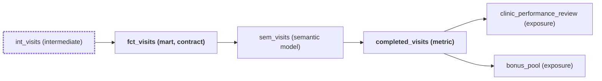
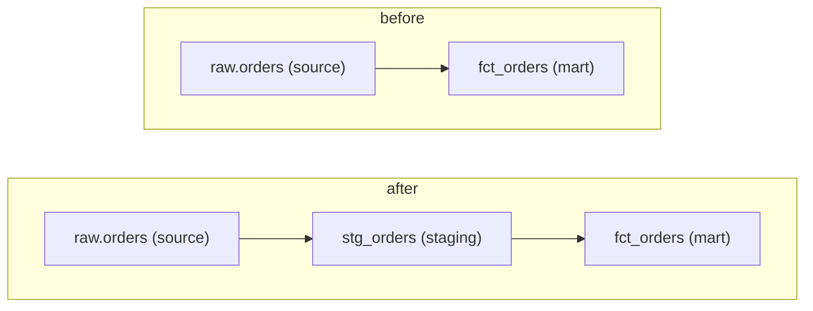

# Diagrams

A diagram earns its place when it shows structure faster than a list: what a change reaches, why two grains differ, how layers move in a refactor. It never replaces the written list, which stays the record a reader can search, quote, and review. Draw only from repository files; a diagram holds model, source, and consumer names, never data values or query results.

## When to draw

- **Blast radius.** A pause, plan, or lineage trace that names three or more downstream consumers (models, semantic models or metrics, BI files, exposures, exports). Fewer than three reads fine as a sentence.
- **Grain decision.** A `# Grain Decision Needed` response: show the two candidate grains and the one-to-many join that separates them.
- **Refactor lineage.** A refactor that adds, removes, or moves a layer: show the chain before and after.

Draw nothing else unless the user asks. Do not draw for a single model, a straight one-input build, a review finding, or to decorate a summary.

## How to draw

Use exactly one fenced `mermaid` block, placed directly after the list it illustrates: `flowchart LR` for a blast radius or grain decision, and the `flowchart TB` before-and-after layout below for a refactor.

- Name each node with its file-level name (`fct_orders`, `sem_orders`, `finance_dashboard`) and give it a short kind label: `fct_orders["fct_orders (mart)"]`.
- Keep it under about fifteen nodes. Past that, group the rest into one node such as `more["4 more dashboards"]` and keep the full list in text.
- Edges point the way data flows: source to staging to mart to consumer.
- Mark what the request changes and what is published, with these two classes only:

- For a grain decision, draw the two tables and the join between them, with each grain as a node: `orders["orders: one row per order"] -->|"1 to many"| items["order_items: one row per order item"]`.
- For a refactor, use `flowchart TB` with two subgraphs, each starting with `direction LR`, and an invisible link `before ~~~ after` so "before" sits above "after". Node ids must be unique across the diagram, so suffix the after-side ids (`fct_orders2["fct_orders (mart)"]`) while the labels keep the real names:

Write valid Mermaid: quote labels that contain parentheses, colons, or spaces; use plain ASCII ids; do not put Markdown inside labels. Some editors show a Mermaid block as code instead of a picture, which is why the text list above it stays complete on its own.
